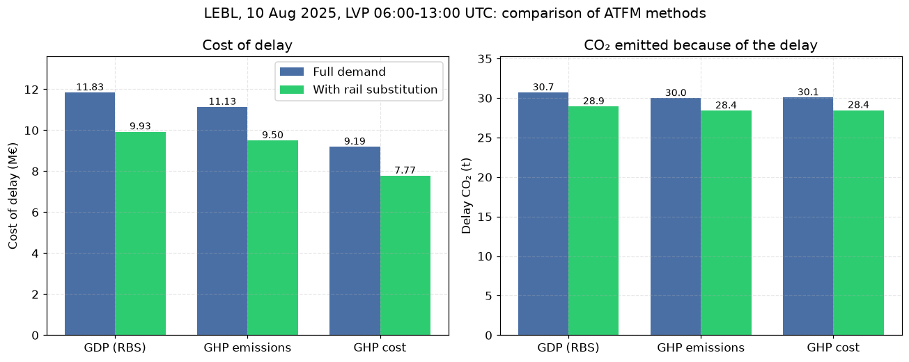
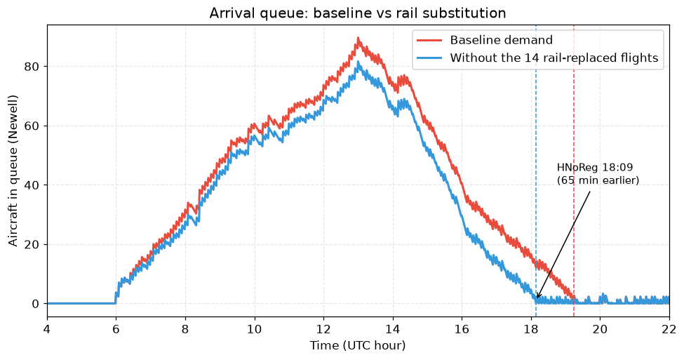

# atfm-gdp-lebl

[](https://github.com/Adh3r/atfm-gdp-lebl/actions/workflows/tests.yml)

**Air traffic flow management simulator for Barcelona–El Prat (LEBL).**
It models a low-visibility capacity drop and compares the ways of absorbing the
resulting arrival delay: a Ground Delay Program allocated by Ration-By-Schedule,
Ground Holding optimisation for cost or for CO₂, and replacing short-haul
flights with high-speed rail.

Built on one real traffic day (10 August 2025, 550 arrivals). The capacity is
cut from 44 to 20 arrivals/h between 06:00 and 13:00 UTC.

> The project was delivered as coursework in May 2026 and revised in November
> 2026. The revision fixed several modelling errors; [`CHANGES.md`](CHANGES.md)
> lists each one and its effect on the submitted results.

## Results

The capacity drop builds a queue of about 90 aircraft. It dissolves at 19:14
UTC (HNoReg), more than six hours after capacity is restored. 415 arrivals are
affected; 361 of them are held on the ground and 54 are exempt.


All methods use the same regulation, slots and affected flights, and absorb the
same 35,680 minutes of delay. What changes is **who** absorbs it:

| | GDP (RBS) | GHP, min CO₂ | GHP, min cost | GDP + rail | GHP cost + rail |
|---|---|---|---|---|---|
| Cost of delay | 11.83 M€ | 11.13 M€ | 9.19 M€ | 9.93 M€ | **7.77 M€** |
| Delay CO₂ | 30.7 t | 30.0 t | 30.1 t | 28.9 t | 28.4 t |
| Max delay | **224 min** | 300 min | 300 min | 213 min | 300 min |
| Airline fairness (RSD of mean delays) | 27 % | 33 % | 49 % | **14 %** | 38 % |
| HNoReg | 19:14 | 19:14 | 19:14 | **18:09** | 18:09 |



- **GHP.** Optimising the slot order on the non-linear Cook & Tanner cost of
  delay cuts the airline cost by 22 % against Ration-By-Schedule. The price is
  fairness: the optimiser moves delay onto the airlines whose flights are
  cheaper to delay, and up to the 300-min cap on single flights. Minimising CO₂
  instead saves only 2.3 %. Ground holding on electrical power emits little, so
  there is not much CO₂ left to optimise.
- **Rail.** 14 regulated flights (Madrid, Alicante, Marseille) have a direct
  high-speed-rail alternative. Replacing them ends the regulation 65 minutes
  earlier, removes 15 % of the delay and saves about 68 t of CO₂, almost all of
  it directly (flights replaced by rail). Door to door, the train only beats
  the *delayed* flight on Madrid.




### How the GHP is solved

Each slot takes one flight, so the ground holding problem
min Σ c<sub>ft</sub> x<sub>ft</sub> is a rectangular linear **assignment
problem**. It is solved exactly with `scipy.optimize.linear_sum_assignment` on
the full cost matrix c<sub>ft</sub> = r<sub>f</sub>(t)·(t − ETA<sub>f</sub>). Any
non-linear cost curve can be used directly, with no linearisation. The tests
check the solver against an independent MILP formulation and against brute
force. The whole pipeline, including 42 sensitivity runs and six GHP
instances, runs in about 25 s.

## What it does

| Work package | Module | Content |
|---|---|---|
| WP1 — Data | `lib_data_prep.py` | Filter LEBL arrivals, join fleet data (RECAT, seats), estimate flown distance and baseline CO₂ ([Montlaur et al., 2025](https://doi.org/10.3390/app15179688)) |
| WP2 — GDP | `lib_gdp_core.py`, `lib_compression.py`, `lib_sensitivity.py` | Newell cumulative curves and H<sub>NoReg</sub>; exemption rules (non-ECAC, airborne, outside radius); RBS slot allocation; air/ground delay split; unrecoverable delay; penalty-and-compression with airline slot ownership; radius × file-time sensitivity heatmaps |
| WP3 — GHP | `lib_ghp_solver.py`, `cost_model.py` | Exact slot assignment minimising delay CO₂ (FEGP ground power vs. airborne burn) or delay cost (Cook & Tanner 2015 tactical costs, primary/full with reactionary, scaled by real passengers); airline fairness |
| WP4 — Intermodality | `lib_intermodal.py`, `generar_graficos_wp4.py` | Door-to-door time and CO₂ for regulated flights with a high-speed-rail alternative; GDP and GHP re-run without them |
| WP5 — Comparison | `lib_metrics.py`, `lib_comparison.py`, `lib_excel_export.py` | One metrics engine for every scenario; final table with KPIs mapped to SESAR KPAs; multi-sheet Excel audit |

## Quick start

```bash
python -m venv .venv
.venv\Scripts\activate          # Windows  (Linux/macOS: source .venv/bin/activate)
pip install -r requirements.txt

cd src
python main.py                  # full pipeline, about 25 s
```

Outputs are written to `data/processed/` (CSV tables and `auditoria_completa.xlsx`)
and `output/figures/` (SVG). The scenario parameters (capacities, regulation
window, radius, file time) live in `src/config.py`.

**Data.** The real traffic day was provided by the course and is not
redistributed. Out of the box, the simulator runs on a synthetic day with the
same layout (`data/sample/synthetic_LEBL_day.csv`), so its numbers differ from
the published results. With access to the original file, place it at
`data/raw/LEBL_10AUG2025.csv`, or point `ATFM_TRAFFIC` at any CSV with the
same columns.

```bash
python -m pytest test -q        # from the repository root
```

## Repository layout

```
data/raw/         fleet and airport tables (real traffic file goes here, git-ignored)
data/sample/      synthetic traffic day
tools/            scripts that rebuild the airport table and the synthetic day
src/              simulator (main.py is the entry point)
test/             pytest suite
data/processed/   generated tables      (git-ignored)
output/figures/   generated figures     (git-ignored)
```

## Terminology

The code and outputs follow the vocabulary of the MGTA course, which teaches
ground delay programs in their FAA/CDM formulation (Ball et al.). European
ATFM uses different names for the same ideas:

| Course / this project | Meaning | European ATFM (EUROCONTROL NM) |
|---|---|---|
| GDP, Ground Delay Program | arrival regulation enforced by holding flights at their origin | ATFM arrival regulation |
| RBS, Ration-By-Schedule | slots rationed in order of scheduled arrival | CASA (Computer Assisted Slot Allocation), "first planned, first served" |
| AAR / PAAR | (Program) Airport Acceptance Rate, arrivals per hour, nominal / during the GDP | regulation rate |
| Hstart / Hend | start / end of reduced capacity | regulation period |
| Hfile, file time | when the regulation is set and slots are sent to airlines | regulation publication; slot (SAM) sent at EOBT − 2 h |
| HNoReg | end of the regulation: the queue has dissolved | — |
| CTD (EDCT) / CTA | Controlled Time of Departure / of Arrival | CTOT (Calculated Take-Off Time) / CTA |
| Controlled | flight that receives ground delay | regulated flight |
| ExemptFlying / ExemptInternational / ExemptRadius | exempt: airborne at Hfile / non-ECAC origin / beyond the radius | flights not subject to the regulation |
| NotAffected | ETA outside [Hstart, HNoReg) | — |
| GHP, Ground Holding Problem | slot assignment as an integer programme with costs c<sub>ft</sub> = r<sub>f</sub>(t)·(t − ETA<sub>f</sub>) | — (research model) |
| Unrecoverable delay | ground delay already absorbed if the GDP is cancelled at Hstart | — |

## Authors

Dènia Cabrera, Adam Ruiz Herrero and Josep Ponz. Developed as a team project for
the MGTA course at EETAC – UPC. See [`CREDITS.md`](CREDITS.md) for who did what
and for the third-party material.

## Licence

GPL-3.0 (required by the bundled emissions model). See [`LICENSE`](LICENSE).
