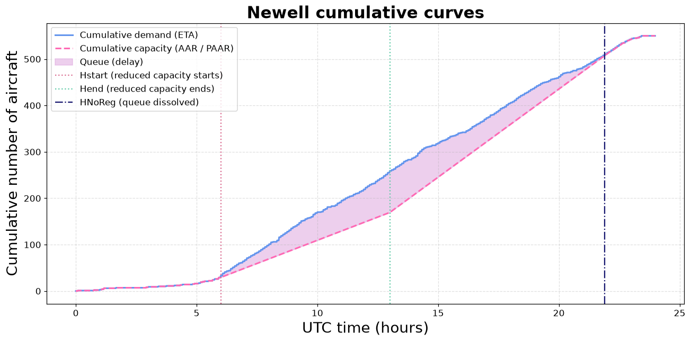
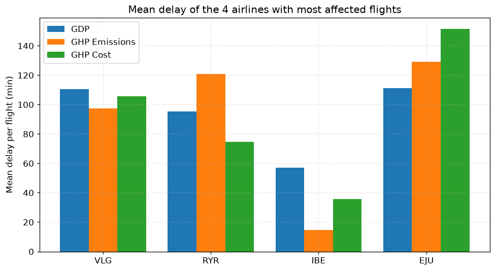
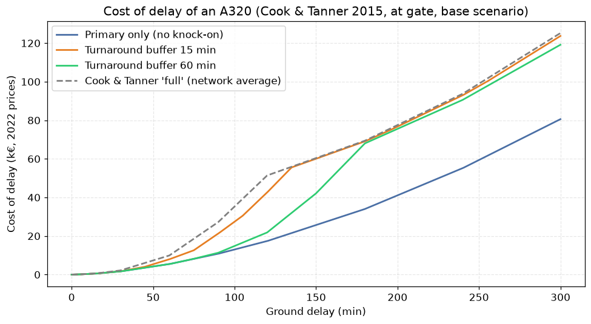

# atfm-gdp-lebl

[](https://github.com/Adh3r/atfm-gdp-lebl/actions/workflows/tests.yml)

**Air traffic flow management simulator for Barcelona–El Prat (LEBL).**
It models a severe weather-related capacity drop and compares the ways of
absorbing the resulting arrival delay: a Ground Delay Program allocated by Ration-By-Schedule,
Ground Holding optimisation for cost or for CO₂, and replacing short-haul
flights with high-speed rail.

Built on one real traffic day (10 August 2025, 550 arrivals). The arrival
capacity is cut from 38 to 20 arrivals/h between 06:00 and 13:00 UTC. 38/h is
the declared arrival capacity of El Prat's main runway configuration and its
peak service rate in EUROCONTROL's airport capacity study.

> The project was delivered as coursework in May 2026 and revised in November
> 2026. The revision fixed several modelling errors; [`CHANGES.md`](CHANGES.md)
> lists each one and its effect on the submitted results.

## Results

The capacity drop builds a queue of about 90 aircraft. Barcelona's demand
stays close to its capacity all day (up to 37 arrivals/h), so the queue only
dissolves at 21:54 UTC (HNoReg), almost nine hours after capacity is restored.
479 arrivals are affected; 418 of them are held on the ground and 61 are
exempt.



All methods use the same regulation, slots and affected flights, and absorb the
same 45,474 minutes of delay. What changes is **who** absorbs it (costs in
2022 euros):

| | GDP (RBS) | GHP, min CO₂ | GHP, min cost | GDP + rail | GHP cost + rail |
|---|---|---|---|---|---|
| Cost of delay | 13.66 M€ | 15.80 M€ | 10.55 M€ | 10.70 M€ | **8.35 M€** |
| Delay passed on to next rotations | 25,000 min | 29,600 min | 23,100 min | 19,600 min | **18,100 min** |
| Delay CO₂ | 94 t | **86 t** | 91 t | 81 t | 80 t |
| Max delay | **225 min** | 300 min | 300 min | 213 min | 300 min |
| Airline fairness (RSD of mean delays) | 24 % | 50 % | 46 % | **16 %** | 22 % |
| HNoReg | 21:54 | 21:54 | 21:54 | **20:34** | 20:34 |


- **GHP.** Optimising the slot order on the cost of delay cuts the airline
  cost by 23 % against Ration-By-Schedule. Most of the saving comes from
  holding first the aircraft whose next departure has slack, which halves the
  reactionary cost. The price is fairness: the optimiser moves delay onto the
  airlines whose flights are cheaper to delay, and up to the 300-min cap on
  single flights. Minimising CO₂ instead cuts delay CO₂ by 8 % by holding
  the aircraft with the smallest APUs longest, but it costs 16 % *more* than
  RBS and is the least fair allocation: it ignores rotations and airlines.
  Cost and CO₂ are conflicting objectives. Both GHP variants are research
  benchmarks: the EUROCONTROL Network Manager allocates slots first planned,
  first served and leaves airlines to reorder their own flights.
- **Rail.** 17 regulated flights (12 Madrid, 4 Alicante, 1 Marseille) have a
  direct high-speed-rail alternative. Replacing them ends the regulation 80
  minutes earlier, removes 16 % of the delay and saves about 87 t of CO₂:
  75 t directly (flights replaced by rail) and 12 t of delay CO₂. Door to
  door, the train only beats the *delayed* flight on Madrid (246 vs 272 min).




### Cost of delay and reactionary delay

The cost of delaying a flight comes from the Cook & Tanner (2015) tactical cost
tables, the reference of the EUROCONTROL Standard Inputs, in 2022 prices as in
their latest edition. Only the passenger component is scaled by the flight's
real passengers (seats × the August 2025 European load factor). A late arrival also delays the next
departure of the same aircraft when the delay exceeds the turnaround buffer.
That is reactionary delay, IATA code 93. The buffer is the scheduled ground
time before the next departure (found through the registration mark) minus a
minimum turnaround time. The cost is therefore:

> primary cost of the delay + reactionary cost of the part of the delay that
> exceeds the buffer

Short delays absorbed by the turnaround cost little; long delays that propagate
cost much more. Cook & Tanner's network-average "full" cost (upper bound) and
the primary cost alone (lower bound) are reported in a sensitivity table. The
GHP optimised on this model beats Ration-By-Schedule under all of them.



### How the GHP is solved

Each slot takes one flight, so the ground holding problem
min Σ c<sub>ft</sub> x<sub>ft</sub> is a rectangular linear **assignment
problem**. It is solved exactly with `scipy.optimize.linear_sum_assignment` on
the full cost matrix c<sub>ft</sub> = r<sub>f</sub>(t)·(t − ETA<sub>f</sub>). Any
non-linear cost curve can be used directly, with no linearisation. The tests
check the solver against an independent MILP formulation and against brute
force. The whole pipeline, including 42 sensitivity runs and eleven GHP
instances, runs in under a minute.

## What it does

| Work package | Module | Content |
|---|---|---|
| WP1 — Data | `lib_data_prep.py` | Filter LEBL arrivals, join fleet data (RECAT, seats), great-circle distance and baseline CO₂ ([Montlaur et al., 2025](https://doi.org/10.3390/app15179688)), scheduled turnaround of each aircraft (registration mark) |
| WP2 — GDP | `lib_gdp_core.py`, `lib_compression.py`, `lib_sensitivity.py` | Newell cumulative curves and H<sub>NoReg</sub>; exemption rules (non-ECAC, flying or ready to depart at H<sub>file</sub>, outside radius); RBS slot allocation; air/ground delay split; unrecoverable delay; cancellations by one airline, substitution and compression with airline slot ownership; radius × file-time sensitivity heatmaps |
| WP3 — GHP | `lib_ghp_solver.py`, `cost_model.py` | Exact slot assignment minimising delay CO₂ (APU fuel at the gate: ICAO Doc 9889 flows, APU on 25 % of the time as in Cook & Tanner, vs. airborne burn) or delay cost (Cook & Tanner 2015 primary cost + reactionary cost of the delay passed on to the next rotation, scaled by real passengers); cost-model sensitivity; airline fairness |
| WP4 — Intermodality | `lib_intermodal.py`, `lib_wp4_figures.py` | Door-to-door time and CO₂ for regulated flights with a high-speed-rail alternative; GDP and GHP re-run without them |
| WP5 — Comparison | `lib_metrics.py`, `lib_comparison.py`, `lib_excel_export.py` | One metrics engine for every scenario; final table with KPIs mapped to SESAR KPAs; multi-sheet Excel audit |

## Quick start

```bash
python -m venv .venv
.venv\Scripts\activate          # Windows  (Linux/macOS: source .venv/bin/activate)
pip install -r requirements.txt

cd src
python main.py                  # full pipeline, under a minute
```

Outputs are written to `data/processed/` (CSV tables and `audit_workbook.xlsx`)
and `output/figures/` (SVG). The scenario parameters (capacities, regulation
window, radius, file time) live in `src/config.py`.

**Data.** The real traffic day was provided by the course and is not
redistributed. Out of the box, the simulator runs on a synthetic day with the
same layout (`data/sample/synthetic_LEBL_day.csv`), so its numbers differ from
the published results. With access to the original file, place it at
`data/raw/LEBL_10AUG2025.csv`, or point `ATFM_TRAFFIC` at any CSV with the
same columns.

```bash
python -m pytest test -q        # from the repository root
```

## Repository layout

```
data/raw/         fleet and airport tables (real traffic file goes here, git-ignored)
data/sample/      synthetic traffic day
tools/            scripts that rebuild the airport table and the synthetic day
src/              simulator (main.py is the entry point)
test/             pytest suite
data/processed/   generated tables      (git-ignored)
output/figures/   generated figures     (git-ignored)
```

## Assumptions and limitations

- **Scenario.** The capacity drop is stylised: fog is rare at Barcelona in
  summer, and thunderstorms are the usual summer capacity limiter. The
  scenario stands for any severe weather reduction of the arrival rate.
- **Demand is fixed.** Airlines do not cancel or retime flights on their own
  during the regulation, except in the WP2 cancellation exercise.
- **Exemptions follow the course.** Every non-ECAC origin is exempt. In the
  real Network Manager system, flights departing from the ATFM adjacent area
  (here 13 flights from Morocco, Algeria, Egypt and Kosovo) also get slots.
- **Cost model.** Cook & Tanner (2015) is still the most recent European
  reference; types newer than its tables (A320neo, A220, A350, 787) are
  mapped to the closest reference type. Reactionary costs are scaled by
  passengers like the primary passenger costs. Connecting passengers are
  covered by Cook & Tanner's network averages (about 9–10 % of passengers
  connect at Barcelona); the traffic file has no flight-level connection data.
- **Emissions.** 3.16 kg CO₂ per kg of fuel, as the course asks
  (EUROCONTROL uses 3.15 in SESAR studies). Distances are great-circle, which
  slightly understates the distance actually flown.
- **Turnarounds.** The 35-min minimum for narrow-bodies comes from the course
  material; low-cost operators schedule down to 25 min, which the cost
  sensitivity (−10 min) covers. Rail journey times are fixed per route.

## Terminology

The code and outputs follow the vocabulary of the MGTA course, which teaches
ground delay programs in their FAA/CDM formulation (Ball et al.). European
ATFM uses different names for the same ideas:

| Course / this project | Meaning | European ATFM (EUROCONTROL NM) |
|---|---|---|
| GDP, Ground Delay Program | arrival regulation enforced by holding flights at their origin | ATFM arrival regulation |
| RBS, Ration-By-Schedule | slots rationed in order of scheduled arrival | CASA (Computer Assisted Slot Allocation), "first planned, first served" |
| AAR / PAAR | (Program) Airport Acceptance Rate, arrivals per hour, nominal / during the GDP | regulation rate |
| Hstart / Hend | start / end of reduced capacity | regulation period |
| Hfile, file time | when the regulation is set and slots are sent to airlines | regulation publication; slot (SAM) sent at EOBT − 2 h |
| HNoReg | end of the regulation: the queue has dissolved | — |
| CTD (EDCT) / CTA | Controlled Time of Departure / of Arrival | CTOT (Calculated Take-Off Time) / CTA |
| Controlled | flight that receives ground delay | regulated flight |
| ExemptFlying / ExemptInternational / ExemptRadius | exempt: airborne or ready to depart at Hfile / non-ECAC origin / beyond the radius | flights not subject to the regulation (departures outside the ATFM area and adjacent area, certain flight types); there is no radius rule |
| NotAffected | ETA outside [Hstart, HNoReg) | — |
| GHP, Ground Holding Problem | slot assignment as an integer programme with costs c<sub>ft</sub> = r<sub>f</sub>(t)·(t − ETA<sub>f</sub>) | — (research model) |
| Unrecoverable delay | ground delay already absorbed if the GDP is cancelled at Hstart | — |
| Substitution | an airline moves its own flights into the slots of its cancelled flights | slot swapping requested by the aircraft operator |
| Compression | slots nobody can use are passed to later flights that can | CASA slot improvement when a slot is released |
| Reactionary delay | delay a late arrival passes on to the next flight of the same aircraft, crew or passengers | reactionary (knock-on) delay, IATA codes 91–96 (93: aircraft rotation) |
| OTP | on-time performance: delay below 15 min | punctuality (CODA) |

## Authors

Dènia Cabrera, Adam Ruiz Herrero and Josep Ponz. Developed as a team project for
the MGTA course at EETAC – UPC. See [`CREDITS.md`](CREDITS.md) for who did what
and for the third-party material.

## Licence

GPL-3.0 (required by the bundled emissions model). See [`LICENSE`](LICENSE).
